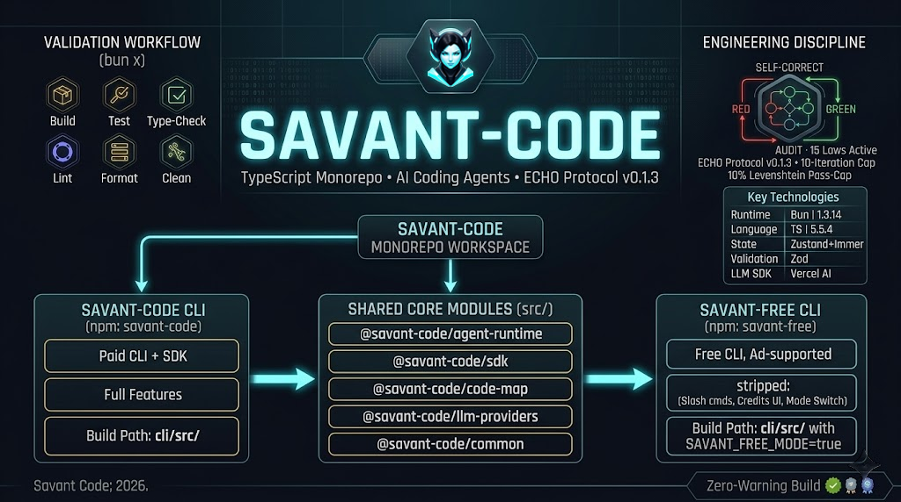

<!-- markdownlint-disable MD041 -->


# @savant-code/common

Shared types, tool definitions, and utilities used across the Savant runtime (Zod schemas, MCP client, AI SDK helpers,
auth, provider registry).

[](../LICENSE)[](../ECHO.md)[](../README.md)

## Purpose

`@savant-code/common` is the **cross-workspace source of truth** for shared types and tool wiring (per ECHO Law 13).
Contains tool schemas for `read_files`, `write_file`, `str_replace`, `run_terminal_command`, `web_search`,
`code_search`, MCP client, AI SDK integrations, and the analytics/billing/Postgres adapters. No agent imports anything
from another workspace without going through `@savant-code/common`.

## Quick Start

The built-in [provider registry](src/providers/registry.ts) is authoritative
for setup credentials, API roots, catalogs, ID transforms, and protocol maps.
CodeCraft and CleanAPIs use OpenAI chat; xKiro's shared exact/prefix resolver
selects Messages for its Anthropic IDs and chat for its other models. CLI
catalog parsers and SDK routing consume this shared contract. See the
[provider/model reference](../docs/providers.md) and
[provider integration runbook](../docs/archive/design/Adding%20New%20Providers.md).

```bash
# From the repo root
bun install

# Type-check common
bun --cwd common typecheck
```

For full Quick Start including how the CLI runtime consumes `common/`, see the [root README](../README.md#repo-map).

## License

[Apache-2.0](../LICENSE) — see [LICENSE](../LICENSE) for full text.

---

<div align="center">

_Part of the [savant-code/savant-code monorepo](https://github.com/savant0x/savant-code), governed by the [ECHO Protocol v0.2.0](../ECHO.md)._

**Savant** • 2026
</div>
