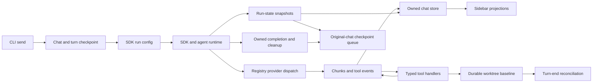

# System data-flow and sidebar audit — 2026-10-02

## Initial state and scope

Requested: review recent completed work, audit system data flow, verify the
lingering day-one defect, assess speed, and inspect sidebar correctness.
Automation level 3; single-agent ECHO, strict mode. No commit, push, release,
or destructive operation is authorized. Current HEAD: `997ce946`; substantial
uncommitted changes from the previous sessions are part of the audit baseline.
The operator has been asked for the exact day-one symptom; independent tracing
continues while that question is pending.

## Intended work and impact

Trace CLI submission through SDK/runtime/provider/tools, streamed events back
into CLI state, sidebar projections, persistence, and cancellation. Check the
October 1–2 completed-work claims against production wiring and executable
tests. Measure suspected hot paths before choosing optimizations. Any code
change will have its exact behavior, compatibility impact, and regression
coverage recorded in a converged FID before implementation. Preserve existing
uncommitted work and use direct file edits after full reads.

## Audit decisions

**Plan:** 3 steps. Subject: verify current system data flow and recent changes.

### Thought 1

The CHANGELOG's October 2 section names enforcement and code-search changes
which `git diff --stat` confirms remain uncommitted. The audit baseline must
include the working tree, rather than using HEAD as the implementation truth.

### Thought 2

Recent work changes enforcement, provider dispatch, and connector tools.
Trace their production callers alongside the CLI event-to-sidebar flow;
run static gates and runtime suites as independent checks.

### Thought 3

Treat prior verification counts as historical claims. Record fresh results and
distinguish executable checks from unperformed live-provider or terminal tests.

### Final

Audit the current tree with reproducible evidence; implement only corrections
whose failure mechanism and regression coverage have been established.

## Audit results and corrections

The review found failures beyond the recent closure claims. Corrections are
implemented under active `FID-2026-1002-002`; operator work is preserved.

| Area | Reproduced failure | Correction |
| --- | --- | --- |
| Enforcement initialization | Every default capture abandoned the real tree | Separate 5-second initial capture budget |
| Enforcement candidates | Dirty-to-clean restoration escaped detection | Persist initial dirty paths and hash their union |
| Chat persistence | Chat switches during checkpoint drain mixed ownership | Recheck chat and run identity after drain |
| Run lifecycle | Late snapshots and cleanup changed a newer run | Guard sidebar, handlers, heartbeat, and finalization |
| Search results | Byte payload earned blank match credit | Reject unsupported payloads with counted diagnostics |
| Search decoding | Buffer boundaries could corrupt UTF-8 | Stateful Node decoding and split-character regression |
| Submission speed | Active-only lookup loaded 434 archives | Read active directory only; preserve existing TTL |
| Sidebar | Unsupported closure claims and short-height clipping | Neutral labels and native vertical scrolling |
| Verification | Fixed line numbers and root workspace filters | Assert source symbols; execute gates in workspace roots |

### Production evidence

- `cli/src/hooks/helpers/send-message-prepare.ts:208` calls the lifecycle with
  `isCurrentRun: () => abortControllerRef.current === abortController`.
- `cli/src/hooks/helpers/send-message-lifecycle.ts:175` guards snapshot dispatch
  before updating tokens/cost; lines 239 and 256 recheck ownership after drain.
- `cli/src/hooks/helpers/send-message-stream.ts:48` exits stale cleanup with
  `if (!params.isCurrentRun)`; `send-message-fn.ts:256` supplies the identity.
- `cli/src/hooks/helpers/send-message-monitors.ts:78` guards the heartbeat;
  `cli/src/utils/create-run-config.ts:203` fences aborted chunks and events.
- `cli/src/utils/fid-loader.ts:206` returns `sortFids(readFidDir(fidsDir))`;
  `cli/src/utils/create-run-config.ts:143` uses `loadFids()` at submission.
- `sdk/src/tools/code-search/schema.ts:8` requires text path and line payloads;
  `sdk/src/tools/code-search/executor.ts:105` owns the stdout decoder.
- `packages/agent-runtime/src/echo/enforcement/tool-pipeline.ts:52` invokes
  baseline capture. `worktree-capture.ts:33` sets the initial budget, and
  `worktree-reconcile.ts:147` includes persisted initial candidates.
- `packages/agent-runtime/src/echo/enforcement/turn-end.ts:56` invokes the
  reconciler. SHA-256 remains the content authority; deletion scanning now
  checks the same turn-end deadline. Legacy baselines without candidate
  metadata use full enumeration rather than guessing which paths changed.
- `cli/src/components/right-sidebar.tsx:167` renders native `scrollbox` with
  the existing scrollbar token factory. Its fold chrome remains outside the
  scrolling viewport. `right-sidebar-sections.tsx:120` says `archived`.
- `scripts/fid-verify.ts:108` resolves an existing workspace; line 116 sets
  its working directory. Gate labels, containment checks, and argv stay intact.

### End-to-end flow

Submission prepares the transcript before invoking the SDK. Runtime callbacks
return text, tool results, and lifecycle events to the CLI. State snapshots
drive meters and coalesced persistence; completion drains that queue before
an authoritative save. Ownership is checked at the mutation and await
boundaries. Abort releases the queue quickly; a late older run cannot clear
the replacement's heartbeat, stream state, provider, or current run state.

### Recent completed-work review

- October 1 OpenAI provider work (`f099ded8`): the prefixed registry route and
  active bare-slug route use the provider's resolved protocol. OAuth remains
  separately gated. The current SDK tests exercise model selection and
  credential boundaries; no paid live request was made.
- Connector meta-tools (`7187d1ec`): all four handlers are registered in
  `packages/agent-runtime/src/tools/handlers/list.ts:86`. Offline compiler,
  schema, replay, catalog-surface, and runtime handler tests passed. External
  provider availability and real credentials were not exercised.
- October 2 enforcement work (archived `FID-2026-1001-003`): the durable read
  ledger and tool/turn-end wiring exist and their suites passed. The real-tree
  capture budget and dirty-to-clean candidate defects required this follow-up.
- October 2 search work (archived `FID-2026-1002-001`): clean no-match versus
  anomaly separation is present. Its original byte fixture accepted a plain
  filename as a bytes payload, concealing data loss. This pass corrects that
  test and adds a real UTF-8 boundary regression. Unsupported bytes are now
  explicit drops, not invented paths or blank successful matches.

## Measured performance

All timings are local wall-clock samples, not throughput or fleet guarantees.

| Probe | Before | After |
| --- | --- | --- |
| Active FID lookup | 70–76 ms, reading 434 archives | 0.35–1.06 ms, one active file |
| Default full baseline capture | 500–508 ms, unavailable/zero files | 1,149 ms, Git/5,138 files |
| Complete reconciliation | 169–170 ms with explicit enlarged capture | 206–210 ms with initial candidates |

After capture, 158 initially dirty paths are preserved as candidates. The
initial capture remains a synchronous, bounded first-write cost; this pass
restores correctness rather than claiming lower startup latency. Turn-end
still has the operator's 500 ms budget. One of three post-change Git status
probes failed and produced an explicit degraded result; the other two were
complete and clean. Existing unavailable persisted baselines cannot recover
earlier mutations retroactively. Oversized-file and no-Git limits remain.

The speed improvement removes archive IO from the foreground submission path
without caching credentials, weakening hashes, or changing provider behavior.
Sidebar full-inventory loading remains necessary for its live archive view.

## Terminal sidebar evidence

Live current-source CLI in isolated Ubuntu/tmux sessions:

- 160×48: header, session rows, both file counters, section controls, fold
  handle, and version render. Final large capture preserves that behavior.
- 100×28 before: Files Changed shows Created but loses Modified despite the
  section being expanded. After: both counters render and overflow scrolls.
- Mouse expansion of Active FIDs: `FID-002` and `434 archived` render; no
  unproved closed/converged claim appears. Wheel scrolling reveals History.
- Ctrl+B folds to the rail and unfolds to the full surface with empty input.
- 45×20: the automatic narrow rail renders and preserves the chat input.

Tokens and existing colors are reused. Raster contrast was not recalculated;
these captures establish layout and interaction, not a new contrast rating.
Live model streaming was not required for these terminal checks; ownership
races are exercised deterministically by the regression suite.

## Verification and limits

Repository `bun run test`: **7,760 pass, 23 skip, zero failures** across all
13 workspaces. The final full typecheck, including scripts, exits 0. ESLint
with zero allowed warnings and changed-code Prettier checks exit 0. Quality
report, repository validation, and Markdown lint pass. Final CLI: 3,771 pass,
18 skip, zero failures. Targeted search integration: 48 pass. Lifecycle ownership: 7 pass.
Worktree capture/reconcile: 14 pass. FID gate executor: 25 pass.
An actual SDK code-search invocation against the current repository returned
three `worktreeBaselineDirtyPaths` matches with intact filenames, line numbers,
and content, and exit code 0; this check used the bundled ripgrep process.

Gate outputs are under `dev/scratchpad/active/system-audit-*`. A restricted
Windows process-tree test and a restricted full CLI run encountered sandbox
access failures; gates requiring those fixtures are rerun unrestricted.
The final CLI run follows the last sidebar layout edit. The final FID receipt
covers all 13 declared gates, using workspace-local test execution.

The exact day-one bug cannot be certified without its symptom or FID. The
operator clarification remains pending. Release binaries, live paid provider
requests, Git commit/push, and publication were not performed. The active FID
and T111 remain until the exact symptom and commit/closure requirements are
resolved; no existing blocked register item was dropped or relabeled.
