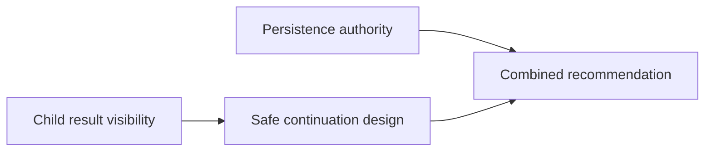

# Live parallel-agent research slice

This isolated experiment compares the existing batch spawn path with a host
coordinator that releases dependent work after individual completion. Both
paths use `SavantCodeClient`, the actual agent loop and `spawn_agents` handler,
real `read_files` results, and Apixo's advertised `gpt-6.1-sol` route.

```powershell
bun scripts/probes/parallel-agent-slice.ts --live
```

The command is deliberately specific to the approved experiment. It requires
`APIXOAI_API_KEY`, performs a public catalog lookup, and refuses to run inference
without `--live`. It changes no saved provider selection or production schema.

## Limits and evidence

The final cumulative ceiling is 60 physical inference sends, including retries
and correction attempts, with two requests in flight, 4,000 output tokens per
request, and 20 minutes per invocation. Each send is recorded before dispatch
in `dev/research/FID-2026-1017-001-request-ledger.jsonl`; subsequent invocations
subtract that ledger from the same budget. This is a request limit, not a
monetary guarantee. Unknown provider pricing/usage is not treated as zero cost.

Each invocation owns a separate SQLite database and report directory under
`dev/research/parallel-agent-slice-*`. Reports retain source fingerprints,
selected artifacts, exact predecessor digests, observed read paths, tool calls,
request timings, and full step histories. Files in that research store are
local and gitignored. Keep the report directory when sharing evidence.
Run one invocation at a time; the cumulative ledger is not a multiprocess lock.

The initial exploratory trials allowed children to choose their read steps.
They exposed provider failure and more child turns than the root step setting
suggested. The final controlled configuration reads assigned files through the
real tool, then permits at most two model turns per child. The initial ceiling
of 36 was revised transparently under the operator's delegated limit authority.
Do not combine timings from different configurations into one comparison.

## Workload



Batch mode submits each ready frontier through one actual spawn batch.
Completion mode uses individual spawn roots and releases a dependent once its
required result is committed. Both use fresh child histories and the same
questions, assigned files, and provider route. The host fixes this dependency
graph; the experiment does not evaluate a model's decomposition decisions.

The prototype stores selected outputs and consumption atomically. It does not
migrate the CLI's filesystem-first restore path or implement production task
leases. Completion mode's separate SDK roots also add setup overhead that a
future integrated service might avoid; report it rather than subtracting it.

## Validation and interpretation

Run control tests from `scripts/`:

```powershell
bun test ./probes/parallel-agent-slice/
```

These test event ordering, cancellation, duplicate suppression, rollback,
source identity, interrupted work, a killed writer process, request ceilings,
and stream permit lifetime. They make no provider requests. Their controlled
artifacts establish storage/control behavior, not model quality or speed.

The live run verifies quoted text within a six-line window beginning at the
reported citation line and checks observed reads and exact handoff digests.
That automatic check does not prove the conclusion follows from the quote or
that a downstream answer semantically used a handoff. Review the actual
answers and traces. A source change invalidates the comparison. Any failed
child makes that wave fail; partial successes remain visible in raw histories.

An upstream failure, exhausted budget, or incomplete candidate run is an
inconclusive comparison. Preserve those outcomes. One completed pair does not
establish a general speedup, a quality improvement, or safe concurrent editing.

## Recorded result, 2026-10-17

The controlled pair completed against source digest
`6ccdadadf823b4e4d5cf1a82c7fa27ca3fd5d3ad225f05b2d27ece45b5a065cf`.
Local evidence: `dev/research/parallel-agent-slice-3FUFjA/report.json`, with
separate full histories and SQLite stores in the same directory.

| Schedule | Wall time | Inference sends | Failed evidence checks |
| --- | ---: | ---: | ---: |
| Batch | 233.895 s | 4 | 13 quotations |
| Completion | 166.292 s | 4 | 7 quotations, 1 handoff digest |

All eight tasks read their assigned source files and returned structured
answers. A's actual output reached C; B and C reached D. However, completion
D returned a changed digest for B. The automatic check rejected that claim.
Several quotations also used inaccurate line numbers or altered source text.
These failures remain in the report; they were not silently repaired.
The runner now exits unsuccessfully when either mode fails evidence checks,
after preserving both modes. This recorded invocation predates that exit rule.

Manual review found useful distinctions between UI child notifications,
batch-delayed reports/accounting, filesystem restore authority, and genuine
user steering. The final recommendations remain provisional: batch C
overstated independent verification of A, while completion C explicitly
acknowledged that its assigned files could not verify the spawn handler.
Neither final synthesis supplies sufficient evidence for a production retrofit.

B finished before A in both modes. Thus C's dependency was the last task in
the initial frontier either way: this pair offered no early-release overlap.
The 67.603 s wall-time difference cannot be attributed to scheduling. This is
one sequentially executed pair with variable provider latency and SDK setup.

Earlier exploratory attempts used 30 sends and ended on upstream errors;
the controlled pair used eight more, for 38 cumulative sends. The remaining
22 are unused. There is no measured monetary cost. No further paid trial is
needed to conclude that evidence validation must precede trusted integration.
