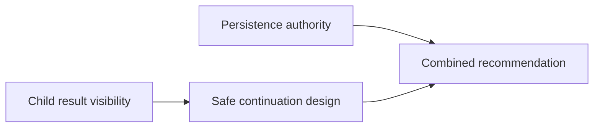

# Live parallel-agent research slice

This isolated experiment compares the existing batch spawn path with a host
coordinator that releases dependent work after individual completion. Both
paths use `SavantCodeClient`, the actual agent loop and `spawn_agents` handler,
real `read_files` results, and Apixo's advertised `gpt-6.1-sol` route.

```powershell
bun scripts/probes/parallel-agent-slice.ts --live
```

The command is deliberately specific to the approved experiment. It requires
`APIXOAI_API_KEY`, performs a public catalog lookup, and refuses to run inference
without `--live`. It changes no saved provider selection or production schema.

## Limits and evidence

The final cumulative ceiling is 60 physical inference sends, including retries
and correction attempts, with two requests in flight, 4,000 output tokens per
request, and 20 minutes per invocation. Each send is recorded before dispatch
in `dev/research/FID-2026-1017-001-request-ledger.jsonl`; subsequent invocations
subtract that ledger from the same budget. This is a request limit, not a
monetary guarantee. Unknown provider pricing/usage is not treated as zero cost.

Each invocation owns a separate SQLite database and report directory under
`dev/research/parallel-agent-slice-*`. Reports retain source fingerprints,
selected artifacts, exact predecessor digests, observed read paths, tool calls,
request timings, and full step histories. Files in that research store are
local and gitignored. Keep the report directory when sharing evidence.
Run one invocation at a time; the cumulative ledger is not a multiprocess lock.

The initial exploratory trials allowed children to choose their read steps.
They exposed provider failure and more child turns than the root step setting
suggested. The final controlled configuration reads assigned files through the
real tool, then permits at most two model turns per child. The initial ceiling
of 36 was revised transparently under the operator's delegated limit authority.
Do not combine timings from different configurations into one comparison.

## Workload



Batch mode submits each ready frontier through one actual spawn batch.
Completion mode uses individual spawn roots and releases a dependent once its
required result is committed. Both use fresh child histories and the same
questions, assigned files, and provider route. The host fixes this dependency
graph; the experiment does not evaluate a model's decomposition decisions.

The prototype stores selected outputs and consumption atomically. It does not
migrate the CLI's filesystem-first restore path or implement production task
leases. Completion mode's separate SDK roots also add setup overhead that a
future integrated service might avoid; report it rather than subtracting it.

## Validation and interpretation

Run control tests from `scripts/`:

```powershell
bun test ./probes/parallel-agent-slice/
```

These test event ordering, cancellation, duplicate suppression, rollback,
source identity, interrupted work, a killed writer process, request ceilings,
and stream permit lifetime. They make no provider requests. Their controlled
artifacts establish storage/control behavior, not model quality or speed.

The original profile checked model-reported lines and digests after execution.
The intermediate `host-bound-evidence-v2` profile asked for exact quotes and
predecessor findings. It rejected altered quotations before publication.
The current `host-reference-evidence-v3` profile supplies an explicit catalog
of real source lines with reference IDs. The model selects supporting IDs;
the host binds their original path, line and text and attaches the digest of
the actual supplied predecessor artifact. Unknown or duplicate references,
unread/unassigned sources, and missing/foreign/duplicate predecessor IDs
reject the result. Provider findings remain unchanged in raw histories.
Downstream assignments include predecessor source files. These profiles are
different evidence tasks; their timing is not pooled with the original.

The scheduler requires validation before publication or dependency release,
checking every member of a returned wave before publishing any of them.
Rejected drafts and mode failures remain in the report and histories. These
checks establish mechanical consistency; they do not prove that conclusions
follow from quotations or that an answer semantically used a predecessor.
Review the actual answers and traces. A source change invalidates comparison.

An upstream failure, exhausted budget, or incomplete candidate run is an
inconclusive comparison. Preserve those outcomes. One completed pair does not
establish a general speedup, a quality improvement, or safe concurrent editing.

## Recorded result, 2026-10-17

The controlled pair completed against source digest
`6ccdadadf823b4e4d5cf1a82c7fa27ca3fd5d3ad225f05b2d27ece45b5a065cf`.
Local evidence: `dev/research/parallel-agent-slice-3FUFjA/report.json`, with
separate full histories and SQLite stores in the same directory.

| Schedule | Wall time | Inference sends | Failed evidence checks |
| --- | ---: | ---: | ---: |
| Batch | 233.895 s | 4 | 13 quotations |
| Completion | 166.292 s | 4 | 7 quotations, 1 handoff digest |

All eight tasks read their assigned source files and returned structured
answers. A's actual output reached C; B and C reached D. However, completion
D returned a changed digest for B. The automatic check rejected that claim.
Several quotations also used inaccurate line numbers or altered source text.
These failures remain in the report; they were not silently repaired.
The runner now exits unsuccessfully when either mode fails evidence checks,
after preserving both modes. This recorded invocation predates that exit rule.

Manual review found useful distinctions between UI child notifications,
batch-delayed reports/accounting, filesystem restore authority, and genuine
user steering. The final recommendations remain provisional: batch C
overstated independent verification of A, while completion C explicitly
acknowledged that its assigned files could not verify the spawn handler.
Neither final synthesis supplies sufficient evidence for a production retrofit.

B finished before A in both modes. Thus C's dependency was the last task in
the initial frontier either way: this pair offered no early-release overlap.
The 67.603 s wall-time difference cannot be attributed to scheduling. This is
one sequentially executed pair with variable provider latency and SDK setup.

Earlier exploratory attempts used 30 sends and ended on upstream errors;
the controlled pair used eight more, for 38 cumulative sends. The remaining
22 remained at the end of that profile. There is no measured monetary cost.
The operator subsequently authorized continued testing at automation level 3;
the v2 profile uses that same cumulative ledger and ceiling.

## Validated continuation, 2026-10-17

FID-2026-1017-002 moved validation before publication and dependency release.
The intermediate v2 pair used five sends and failed on altered quotations:
batch B joined comment lines, and completion B reworded a database comment.
Batch published nothing; completion accepted A and began C, then stopped C
after B failed. D never ran. Evidence remains in
`dev/research/parallel-agent-slice-U4By14/`. This is a rejection-control result,
not a completed timing comparison. One interrupted stream lacks a recorded
finish time; its dispatch still counts against the ceiling.

The v3 pair completed against the same source fingerprint as the original.
Local evidence: `dev/research/parallel-agent-slice-qygYWL/report.json`, full
histories and separate SQLite stores. Source-reference selection adds input
catalogs and downstream source access, so compare these two modes with each
other, not with the original profile.

| Schedule | Wall time | Inference sends | Failed mechanical checks |
| --- | ---: | ---: | ---: |
| Batch | 96.997 s | 4 | 0 |
| Completion | 89.762 s | 4 | 0 |

All eight tasks read all their assigned files: A two, B three, C five and D
nine. Inspection of each child's actual history found the exact predecessor
artifact and digest: A in C; B and C in D, in both modes. Each owner contains
four accepted artifacts; its revision advanced three times for batch frontiers
and four times for individual completions. All eight inference streams have
recorded completion times. C began 21 ms after A completed in completion mode,
but B had already finished 2.981 s earlier. Batch B also finished before A.
Thus there was no useful sibling overlap in this pair; the 7.235 s difference
does not establish a scheduling advantage.

Manual review confirms useful source-grounded distinctions: streamed lifecycle
events versus batch-delayed reports/cost aggregation; filesystem-first restore
versus SQLite fallback; checkpoint draining versus acknowledged durable commit;
and genuine user steering versus synthetic compliance messages. The final
syntheses preserve the existing batch join. They therefore do not supply a
production asynchronous scheduler design. Some prose uses additional inline
reference IDs beyond its selected citation list; the mechanical verdict checks
the selected structured citations, not every prose claim or its entailment.

The concrete candidate for a next implementation experiment is a parent-owned
task service with immutable task/attempt/generation identity, validated results,
transactional delivery and acknowledgement, and consumption at safe parent
step boundaries. Keep existing aggregate spawn semantics until a separate
asynchronous contract is defined. The control suite proves early release under
controlled ordering; representative live work with an independently slower
branch is still needed to measure useful overlap. No synthetic delay was used.

At the end of this continuation, cumulative inference use was 51/60: 38 original, five rejected v2,
eight successful v3. Nine remain unused; no new run is needed to establish
this mechanical information-flow result. Monetary cost remains unmeasured.
This is an isolated research harness, not a production readiness verdict.

## Workflow comparison continuation

The operator then authorized broader workflow/intra-agent investigation.
`--live --workflows` compares fused, independent fan-out and dependent-chain
investigation with the same final brief. Its nine sends completed the original
60-request allowance. Fused took 41.230 s but proposed unsafe cost handling;
flat took 90.202 s and chain 91.603 s, with no clear timing advantage.

The prepared `--live --review-workflows` candidate uses two fresh draft/review
trials and requires four additional sends. It is blocked at the existing
ceiling pending operator allowance. Results, common semantic review, source-read
receipt checks and the build contract are in
[the workflow decision](parallel-workflow-decision.md). No additional send has
been made and no production workflow is installed.
